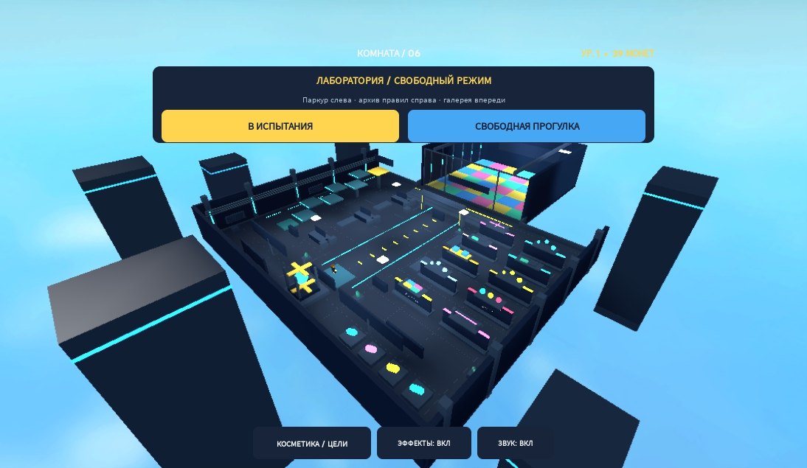

# Комната, которая меняет правила

Игровая альфа Roblox: лабораторный комплекс, шесть испытаний за забег, общий финал и зарабатываемая косметика. Основной репозиторий — [ikanit1/boblox](https://github.com/ikanit1/boblox). Исходники Rojo в этом репозитории — источник истины. Эта ветка — кандидат расширения карты; до review и слияния `main` остаётся прежним.



**Расширение лаборатории:** поле 84×84, комплекс ожидания 180×144, паркур с семью точками и личным временем, архив десяти правил, смотровая галерея, шкафчик и отдельный режим прогулки. Во время ожидания нажми «ЛАБОРАТОРИЯ», чтобы остаться и потренироваться; «В ИСПЫТАНИЯ» вернёт в очередь. [Что изменено и проверено](docs/LAB_EXPANSION.md).

Режим рассчитан на 1–12 игроков. Можно играть одному; фактическая многопользовательская проверка выполнена в Studio с двумя клиентами. Это локальная игровая сборка: публикация в Roblox и коммерческий запуск ещё не выполнены. Результаты и ограничения — в [QA_REPORT.md](docs/QA_REPORT.md).

## Играть

1. Запустите **Start.cmd** в папке проекта. Он проверит исходники, соберёт `build/RuleRoom.rbxlx` и откроет его в Roblox Studio.
2. Если Studio запрашивает вход, войдите своим аккаунтом.
3. Нажмите **Play / F5**. Управление: **WASD** и **пробел**; кнопки интерфейса выбираются мышью. На телефоне — стандартные джойстик и кнопка прыжка Roblox, горизонтальная ориентация.

После восьми секунд голосования начинаются пять различных испытаний, затем общий финал «Заряди реактор». Перед опасностью показывается предупреждение. При поражении персонаж возрождается в зоне ожидания и возвращается в **следующее испытание** с полным здоровьем. После итогов следующий забег начинается автоматически.

Для запуска на другом компьютере нужны Roblox Studio, Python 3 и CLI: Rojo, StyLua, Selene, Luau и Lune. На подготовленном компьютере они уже установлены. Версии, официальные источники и контрольные суммы — в [toolchain.json](docs/toolchain.json); настройки инструментов — в [rokit.toml](rokit.toml).

На новой Windows-машине установите закреплённые CLI из официальных релизов:

```powershell
python tools/bootstrap_tools.py
& "$env:LOCALAPPDATA\RobloxDev\bin\rojo.exe" plugin install
```

Bootstrap проверяет SHA256 архивов. Roblox Studio устанавливается отдельно с официального сайта; CI не устанавливает Studio и не входит в аккаунт.

## Что входит в альфу

- **Десять правил:** нужный цвет, движущийся лазер, лунная гравитация, красный свет, лава, метеоры, исчезающие плитки, безопасная зона, вращающийся луч, общий реактор.
- **Голосование:** Микс, Реакция и Космос меняют частоту выбора испытаний. Повторов внутри забега нет; финал всегда шестой.
- **Очки, монеты, опыт и победы.** Пройденное испытание: 12 монет и 20 XP; звезда: 2 монеты и 3 XP. Завершённый забег с хотя бы одним успехом: 15 монет и 25 XP. Для победы нужны четыре успешных испытания, выживание в финале и заряженный реактор; бонус — 20 монет.
- **Четыре открываемых следа:** 60, 100, 180 и 260 монет. Косметика не даёт преимущества в движении.
- **Три ежедневных задания:** пройти 8 испытаний, собрать 10 зарядов/звёзд, завершить 2 забега. Награды — 50, 50 и 60 монет. Обновление — по UTC; штрафов за пропуски нет.
- **Русский интерфейс:** правило и таймер, прогресс забега, голосование, магазин за монеты, задания, итоги, наблюдение за живыми игроками, уменьшение движения.
- **Серверная логика:** проверка покупок и наград, ограничение запросов, восстановление арены, профили с защитой от конкурирующих записей, проверка правдоподобия движения.

Добавлены короткие сигналы смены правила, отсчёта, урона, награды, кнопок и завершения забега; звук отключается отдельной кнопкой. Используются встроенные файлы Roblox, без сторонних audio ID. Музыкального сопровождения и Robux-продуктов пока нет. Проверка движения прошла отдельный сценарий в Studio: обычные прыжки разрешены, перенос и зависание исключают награду. Точная область проверки — в отчёте QA.

## Сохранения

В Studio по умолчанию работает **временный профиль**: монеты, опыт, покупки и задания исчезают после завершения тестовой сессии. Интерфейс сообщает этот режим. `Score` и `Best` — очки текущей серверной сессии.

Для опубликованной игры реализовано облачное хранение монет, XP, побед, косметики и заданий через `UpdateAsync`, аренду сессии и автосохранение. Реальные загрузка, повторный вход и восстановление после сбоев ещё требуют проверки в отдельном опубликованном тестовом месте. Ошибка загрузки или занятый профиль дают явно обозначенную временную игру; пустые данные не перезаписывают существующий профиль.

Настройки — в [EconomyConfig.luau](src/shared/EconomyConfig.luau). Намеренный тест DataStore в Studio требует одновременно `StudioDataStoreEnabled = true` и совпадающего положительного `TestPlaceId`. Используется отдельный store `RuleRoomProfiles_TEST_v1`; основной — `RuleRoomProfiles_v1`. Доступ к API нужен для облачного теста; обычный локальный запуск его не требует.

Локальный стенд сохранений выполняет настоящий `ProfileService` с управляемыми ответами хранилища: покупка, задание, запись, независимая повторная загрузка, конфликт сессий и сетевые сбои. Это не обращение к Roblox DataStore. Подробности — [SAVES.md](docs/SAVES.md).

## Разработка

```powershell
# Генерация, проверки исходников, сборка, тесты, проверка модели
.\Build.ps1

# Синхронизация исходников через Rojo
.\Serve.ps1
```

`Serve.ps1` слушает `127.0.0.1:34872`. Откройте нужное место в Studio и подключите плагин Rojo к этому адресу через **Connect**. Одного запущенного сервера недостаточно.

| Путь | Назначение |
|---|---|
| `src/server/` | Забеги, опасности, участники, профили, аналитика |
| `src/shared/GameConfig.luau` | Правила, длительности и отображаемые названия |
| `src/shared/RuleDeck.luau` | Выбор колоды и результат голосования |
| `src/shared/EconomyConfig.luau` | Каталог, награды, задания, параметры хранения |
| `src/client/` | HUD, кнопки, наблюдение и косметические эффекты |
| `tools/build_assets.py` | Исходник арены и интерфейса |
| `assets/*.rbxmx` | Генерируемые модели для Rojo |
| `tests/` | Чистые тесты экономики, колоды, геометрии и ограничений движения |

Правьте исходники, затем собирайте или синхронизируйте. Изменения только в генерируемом месте, XML или соответствующем поддереве Studio исчезнут при следующей генерации. Живой сценой управляет один агент; остальные работают в назначенных файлах.

## Roblox Studio и агент

Используется [официальный плагин Roblox](https://github.com/Roblox/roblox-studio-agent-plugin) и встроенный [MCP-сервер Studio](https://create.roblox.com/docs/studio/mcp). Имя подключения — **Roblox_Studio**; второй сервер создавать не нужно.

При открытом месте: **Assistant → … → Settings → MCP Servers → Enable Studio as MCP server**. В некоторых версиях пункт называется **Manage MCP Servers**. Если доступен **Quick Connect → ChatGPT (codex)**, он настраивает подключение. Пользователь выполняет вход и включает переключатель; пароль или коды агенту не нужны.

На Windows используется штатный wrapper, который следует за установленной версией Studio:

```text
cmd.exe /c "cd /d %LOCALAPPDATA%\Roblox && .\mcp.bat"
```

Команда сервера — `cmd.exe`; аргументы — `/c` и `cd /d %LOCALAPPDATA%\Roblox && .\mcp.bat`. Путь к `StudioMCP.exe` внутри конкретной папки версии не закрепляется. Если подключение добавлено после начала беседы, может потребоваться новая беседа Codex. Работоспособность проверяется через `list_roblox_studios` и `get_studio_state` для нужного места.

## Документы и следующий этап

- [План RuleRoom 1.0](docs/ROADMAP.md) — фактическая инвентаризация, приоритеты, зависимости и способы приёмки.
- [Критерии выпуска](docs/RELEASE_CHECKLIST.md) — открытые проверки и условия ограниченного запуска/отката.
- [Дизайн режима](docs/GAME_DESIGN.md) — игровой цикл, контент, экономика и продуктовые гипотезы.
- [Исследование Roblox](docs/RESEARCH.md) — источники по рекомендациям, первому сеансу и удержанию.
- [Skills и инструменты](docs/SKILLS.md) — установленный и найденный комплект для агентов.
- [Технический контракт альфы](docs/ALPHA_CONTRACT.md) — API, атрибуты, владение файлами.
- [Звук и происхождение ассетов](docs/AUDIO.md), [проверка сохранений](docs/SAVES.md).
- [Матрица тестов](docs/PLAYTEST.md) и [фактический отчёт QA](docs/QA_REPORT.md).
- [Исторический CONTRACT.md](docs/CONTRACT.md) описывает ранний прототип с тремя правилами; актуальный документ — `ALPHA_CONTRACT.md`.

Перед публичным запуском нужны проверка облачных профилей, финальная регрессия и реальные устройства, слуховая оценка микса, независимые игроки, настройка публикации и анализ первых сеансов. Техническая работоспособность не доказывает удержание, популярность или будущий доход.
