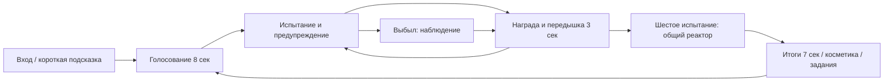

# Комната меняет правила — дизайн режима

Версия дизайна: 0.2, 23 октября 2026. Основной репозиторий: [ikanit1/boblox](https://github.com/ikanit1/boblox). Это проектное решение; интерес и удержание ещё предстоит измерить на игроках. Технический контракт — [ALPHA_CONTRACT.md](ALPHA_CONTRACT.md), фактическое качество сборки — [PLAYTEST.md](PLAYTEST.md).

## Обещание игроку

«Комната придумывает новое испытание каждые двадцать секунд. Смотри на подсказку, справляйся вместе с друзьями и доберись до общего финала». Основные действия — двигаться, прыгать, выбирать позицию. Игроку не нужен длинный учебник или знание сложных кнопок.

Жанр: социальные испытания на выживание. 1–12 игроков, компьютер и телефон; геймпад поддерживается стандартным управлением Roblox и выбором кнопок интерфейса, но требует отдельной проверки. Один узнаваемый мир превращается на глазах. Ядро — решения и освоение правил; уровни дают самовыражение, а не преимущество в физике.

## Почему хочется сыграть ещё

1. **Понятно, что делать.** Одно действие, одна короткая инструкция, видимая опасность. Цвет дублируется знаком и словом.
2. **Проигрыш обучает.** Причина читается на экране. Следующее испытание возвращает игрока в игру; он не наблюдает несколько минут за чужим успехом.
3. **Меняется задача.** Нужно узнавать цвет, выбирать укрытие, двигаться к зоне, останавливаться, прыгать или собирать энергию. Ускоренный вариант того же лазера не считается новой механикой.
4. **Есть личный и общий результат.** Очки и лучший забег позволяют соревноваться; общий реактор даёт повод помогать.
5. **Небольшая достижимая цель.** Заработать первый след, пройти четыре испытания, закрыть задание. Нет обязательного ежедневного входа и штрафа за пропуск.

## Забег

Пять различных испытаний выбираются из девяти; шестое — ReactorRush. Цель длительности забега — 2–3 минуты. Голосование меняет распределение испытаний: Balanced — смесь; Reflex — больше реакции; Cosmic — больше движения и сбора. Ничья разрешается сервером. Голос бесплатный и одинаковый по весу.

Все участники следующего испытания получают полное здоровье. Поздно подключившийся ждёт только ближайшей границы испытания. Ожидание объясняется таймером и наблюдением. Если все выбыли, опасность досрочно прекращается. Пол, гравитация и временные объекты восстанавливаются перед каждым новым испытанием.

## Каталог первой альфы

| Испытание | Решение игрока | Предупреждение и ограничение |
|---|---|---|
| Цвет спасает | Найти плитку с нужным знаком | Название + знак + цвет, время перебежать; не прятать нужный цвет |
| Лазер | Перепрыгнуть движущийся луч | Сначала безопасный показ, затем видимое движение; без попадания каждый кадр |
| Лунная комната | Выбрать траекторию к звёздам | Гравитация меняется после подсказки; сбор проверяет сервер |
| Красный свет | Остановиться вовремя | Переходный запас времени; проверка перемещения после него |
| Лава | Заранее занять платформу | Подъём после предупреждения; платформы достижимы обычным прыжком |
| Метеоры | Читать отметки и уходить | Сначала зона удара, потом урон; остаётся путь отхода |
| Исчезающий пол | Планировать следующий шаг | Плитки предупреждают до исчезновения, не вся арена сразу |
| Безопасная зона | Добежать до отмеченной зоны | Достаточно времени пересечь комнату; зона различима без цвета |
| Вращающийся луч | Рассчитать момент прыжка | Видимая ось/луч, плавное движение, ограничение частоты урона |
| Реактор | Вместе собрать заряд и избегать луча | Цель зависит от числа начавших финал, режим работает в одиночку |

Случайность выбирает испытания и допустимые позиции, но не отменяет проходимость. Ускорение, ветер, туман и сочетания произвольных правил — следующий этап после реальных тестов. Разрешённая комбинация первого финала заранее известна: сбор энергии + один луч при обычной гравитации.

## Первые минуты

- Вход: комната видна, на экране управление и ближайшее действие, магазин не открывается сам.
- Первое испытание: контекстная инструкция, крупный таймер, без цепочки окон.
- Первый успех: прибавка очков, монет и опыта; видна ближайшая косметическая цель.
- Первая ошибка: игрок узнаёт, когда вернётся, и может наблюдать за живым участником.
- Первые итоги: личные очки и общий результат; следующий забег начинается автоматически после короткой паузы.

Цели измерения, а не обещание результата: осмысленное действие в первые 20–30 секунд; 8 из 10 наблюдаемых новичков понимают первое правило без подсказки взрослого; хотя бы половина добровольно начинает второй забег. Маленькая выборка годится для поиска ошибок, а не для доказательства будущего дохода.

## Прогресс и экономика

Мягкая валюта — монеты. За пережитое испытание 12 монет и 20 XP; за подобранную звезду 2 монеты и 3 XP. За законченный забег с хотя бы одним успехом 15 монет и 25 XP. Победа требует четырёх успешных испытаний, выживания в финале и общего заряда; даёт дополнительную награду. Точные величины в EconomyConfig, их меняют после замеров.

Четыре зарабатываемых следа стоят 60/100/180/260 монет. Первый можно получить после примерно одного успешного забега. Свойства движения у всех одинаковые. Каталог постоянный, без лотереи; выбранный предмет сохраняется вместе с владением.

Три задания: пережить 8 испытаний, собрать 10 звёзд, закончить 2 забега; награды 50/50/60 монет. Новый календарный день обновляет задания, не отнимая прежние покупки и монеты. Награда за задание выдаётся один раз. Временное ожидание на сервере не увеличивает прогресс.

Для производственного запуска важны загрузка, конкурентные сессии, повторная доставка запросов и сбои хранилища. В Studio используется временный профиль; реальные сохранения проверяются в отдельной опубликованной тестовой игре. Не загруженный профиль нельзя заменить пустым при сохранении.

## Визуальный и звуковой язык

Стиль — светлая по смыслу, тёмно-синяя по архитектуре лаборатория: крупные цветные плитки, белая типографика, неоновые акценты, центральная испытательная площадка. Опасность занимает мир, интерфейс только поясняет её. Силуэты и знаки важнее мелкой декоративной детализации.

Функциональные сигналы: короткий отсчёт, смена правила, получение награды, попадание, завершение реактора. Все звуки должны иметь проверенное происхождение и разрешения Roblox. Короткие функциональные сигналы реализованы на встроенных звуках Roblox с ограничением частоты и кнопкой отключения; происхождение описано в AUDIO.md. Музыка и слуховая оценка полного микса остаются отдельной задачей перед публичным релизом. Сильная тряска камеры не требуется; предусмотрено уменьшение движения.

## Заработок после проверки ядра

Продуктовая гипотеза — наборы внешнего вида, дополнительные стили следа/появления, эмоции и оформление имени с честным превью. Не продаём силу, иммунитет, право повторно войти в текущую опасность или дополнительный вес голоса. Это выбранная модель игры, а не утверждение, что Roblox запрещает все другие модели.

Robux-товары, цены, product/pass IDs и обработка покупок не включаются с фиктивными значениями. Их вводят после оценки бесплатного режима и теста выдачи/повторной доставки покупок. Доход не гарантируется; исходники на GitHub не означают опубликованную игру.

## Что добавлять по результатам наблюдений

Если скучно между испытаниями — улучшать возвращение и наблюдение. Если игрок не понимает смерть — улучшать предупреждение и причину. Если освоил всё за два забега — добавить новый тип решения и разрешённую мутацию. Если не возвращается через неделю — развивать мастерство, коллекцию и совместные цели. Если неудобно на телефоне — сначала исправлять читаемость/управление, затем привлекать новых игроков.

Приоритет следующего контента: ещё две механики, другая архитектура комнаты с теми же понятными правилами, 2–3 проверенных сочетания, совместная цель друзей. Обмен, питомцы, сезонный пропуск, кланы и десять валют не нужны для проверки этой идеи.
