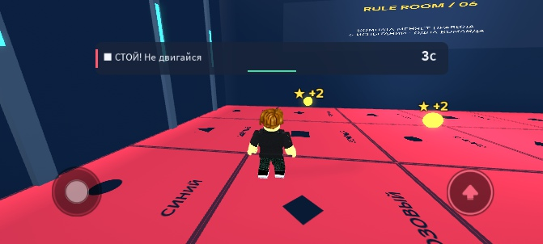
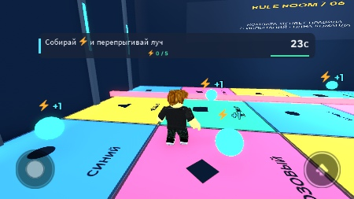
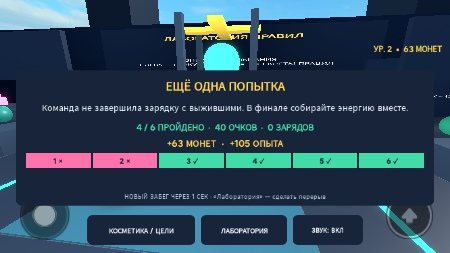
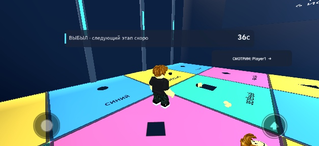

# Игровой цикл и мобильный интерфейс — 26 октября 2026

Кандидат `feat/playable-game-loop` продолжает расширение лаборатории из PR7. Это локальная сборка для review и плейтеста, не релиз в Roblox.

## Что изменено

- Новичок сначала выбирает «ИГРАТЬ» или «ОСМОТРЕТЬСЯ». Сервер принимает в испытания только после этого выбора; прогулка остаётся отдельной от очереди.
- Между испытаниями выжившие остаются на восстановленной арене. После поражения игрок возвращается в следующем испытании с полным здоровьем. Ожидание результатов увеличено до 12 секунд.
- Личный журнал показывает успех, поражение или пропуск каждого этапа. Монеты и XP на итоговом экране берутся из фактического изменения профиля при игровых наградах; покупки и получение заданий не входят в заработок забега. Победа зависит от личного выживания в финале и командной энергии.
- Лава держит игрока на платформе 8 секунд после предупреждения вместо 14. Сервер отдельно сообщает подготовку, активную опасность и безопасную фазу; звук реагирует на волны и личные исходы.
- Исправлены модальное перекрытие/фокус, повторные звуки результатов, неверное предупреждение об уроне после Reset и шкала реактора поверх сообщения о поражении.

## Телефон

Первую компактную версию пользователь отклонил: в кадре помещались надписи, но игровой обзор был перекрыт. Проверка `TextFits` оказалась недостаточной для оценки удобства. Автоматический водитель в том тесте также скрывал штатные сенсорные кнопки.

Теперь во время Rule/Break используется отдельная композиция: верхняя полоска **48 px** с короткой командой и таймером, здоровье и заряд финала внутри неё. Заголовок игры, длинное описание, шесть этапов, статус и кнопки настроек скрыты. Уведомления о повреждении/выбывании подавлены; короткая строка награды допускается в безопасной фазе и лунной комнате. Полные меню доступны между забегами. Цвет сопровождается символом, красный сигнал — явной командой «СТОЙ».

В чистом Play без водителя движения проверены iPhone 17 Pro (фактический viewport 750×381), Galaxy A06 (705×338) и iPhone 7 (666×374). TouchGui и стандартный PlayerModule оставались включены, панель не пересекалась с джойстиком/прыжком. Нативная кнопка первого входа дала один `Activated` и серверное подтверждение. Переход телефон → desktop восстановил полоску этапов непосредственно при изменении размера. Это визуальная/геометрическая проверка Device Simulator, **не приёмка физического multi-touch**. Данные — [mobile-layout.json](qa/mobile-layout.json).

Отдельно проверен экран поражения/наблюдения после контролируемого зависания в fixture с production roster: сообщение осталось в полоске, энергия и настройки скрылись, кнопка наблюдения расположилась сверху справа. Диагностический водитель к этому моменту завершился и вернул обычное управление (`controlsEnabled=true`, `driverOwnsControls=false`).

## Production-цикл

Два настоящих клиента Studio прошли два забега с обычным Main и настоящим ProfileService в режиме Session. Движение обеспечивал диагностический LocalScript через обычные MoveTo/Jump; телепортации для решения правил не применялись. Это не человеческий плейтест.

| Забег / игрок | Этапы | Личный исход | Монеты / XP за забег | Победы профиля |
|---|---|---|---|---|
| 1 / Player1 | 6/6 | Won | 129 / 178 | 1 |
| 1 / Player2 | 5/6 | Won | 105 / 140 | 1 |
| 2 / Player1 | 1/6 | FinaleMissed | 27 / 45 | 1 |
| 2 / Player2 | 5/6 | Won | 123 / 167 | 2 |

Журнал наград совпал с изменениями профилей, 39 наблюдений передышки не обнаружили выжившего, отправленного в дальнее лобби. Исходный [полный отчёт](qa/production-loop-observation.json) сохранён вместе с дефектом: в первом забеге Player2 получил Airborne при обычных прыжках через лазер. По фазовым снимкам нельзя установить точную пропущенную траекторию.

Серверная проверка теперь сбрасывает недостоверный непрерывный полёт после пропуска наблюдений более 250 мс. Возможное пропущенное приземление принимается только при падении → подъёме рядом с одним подтверждённым полом и соответствии времени/высоты баллистике. Пределы 4/7 секунд сохранены; добавлены диагностические атрибуты отказа. 13 новых математических проверок включают обычный прыжок, высокий разворот, зависание и нечисловые значения.

## Проверки текущего кандидата

Свежая регрессия завершена: **все 10 правил, 12 сценариев, два настоящих клиента**. Лазер выполнен три раза всего, включая переход после лунной гравитации. Оба игрока выжили в каждом из 12 сценариев, новых MovementViolation нет; повторные вызовы AwardSurvivors/CompleteRun не выдали повторных наград; восстановление арены прошло 12/12. Финал завершён с двумя выжившими и энергией 11/5. Подробные временные ряды — [playable-rule-regression.json](qa/playable-rule-regression.json). Здесь используются production rules/roster, обычные MoveTo/Jump и счётчик наград; это не проверка облачных профилей или удобства управления человеком.

Отдельный adversarial fixture с настоящим CheckBoundaries отверг закреплённое зависание через 4.0305 секунды: Airborne, выбывание и ноль наград; стоящий на полу второй клиент получил награду один раз. Это ограниченная регрессия исправления, не доказательство полного античита. Первый запуск этого дополнительного fixture был невалиден: в нём не вызывался CheckBoundaries; он исключён из приёмки, fixture исправлен и запущен повторно.

Итоговый манифест — [playable-loop.json](qa/playable-loop.json). Multiplayer остановлен, QA-скрипты удалены из Edit, Main и Station снова включены. Сборка `build/RuleRoom.rbxlx` генерируется из исходников без диагностических fixture.

Локальная сборка прошла: StyLua, Selene без ошибок/предупреждений, компиляция 29 Luau-файлов, Rojo, проверка 1025 экземпляров места. PracticeMath 17, ProfileData 59, RuleDeck 22 519, RuleMath 82, RunPresentation 15; ProfileService 27 проверок в девяти сценариях с локальными адаптерами. Vault: 20 заметок, 95 ссылок, без ошибок.

## Оставшиеся ограничения

Физический телефон, управление реальным геймпадом, слуховая оценка микса, длительная нагрузка и внешний плейтест не приняты. В этом проходе участвуют два клиента; 4/8/12 игроков не заявлены проверенными. Реальные облачные сохранения и Roblox-публикация остаются вне текущего разрешённого локального теста. Счётчики звуков подтверждают события и загрузку встроенных файлов, но не качество звучания.

В клиентском Output остаётся ранее известное предупреждение `rbxassetid://203785492: Asset type does not match requested type`; этого ID нет в исходниках игры. Оно не подменяет проверку игровых ошибок. Результаты этой итерации не доказывают удержание игроков, популярность или доход.
