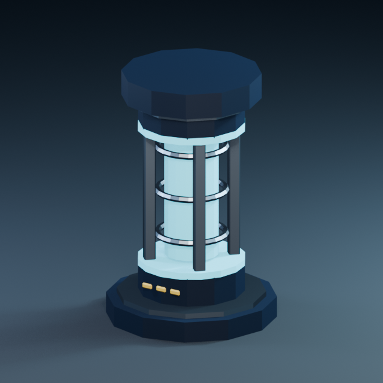

# Blender и создание 3D-ассетов RuleRoom

Проверено 24 октября 2026. Существующий Blender из Steam сохранён: **5.2.2 LTS**, build `d13f752e3b9c`, `D:\Steam\steamapps\common\Blender\blender.exe`. Переустановка Blender не требовалась.

## Подключение

Выбран **официальный Blender Lab MCP**, исходники [lab/blender_mcp](https://projects.blender.org/lab/blender_mcp), commit `dbbf836ad4b1025f14a2b3b504c43903f39e0b04`. Проверены README, Python package и код add-on/socket; лицензия инструмента GPL-3.0-or-later. Серверный пакет `blender-mcp==1.0.2`; add-on manifest `1.0.0`, Blender minimum `5.1.0`. Страница [Blender Lab](https://www.blender.org/lab/mcp-server/) была недоступна веб-инструменту (402/403); официальный Git-репозиторий загрузился и использован напрямую. Сторонний backend не устанавливался.

Нужны оба компонента: Python MCP process и add-on внутри Blender. Реальный handshake, `tools/list` (**26 инструментов**), `get_objects_summary` и read-only `execute_blender_code` прошли. Одной записи в конфигурации недостаточно; root отдельно проверяет регистрацию Codex.

Машинный runtime находится в `LocalAppData/RobloxDev/blender-mcp-official`; при установке из MSIX Codex Windows перенаправила его в физический каталог:

`C:\Users\admin\AppData\Local\Packages\OpenAI.Codex_2p2nqsd0c76g0\LocalCache\Local\RobloxDev\blender-mcp-official`

В `deployment.json` записаны точная команда, аргументы и SHA256 скопированных `launcher/run_mcp.py` и `launcher/start_bridge.py`. Codex использует эту стабильную копию; перенос рабочего Git-каталога не ломает запуск. После изменения проектных скриптов повторить bootstrap и сверить deployment; обычная сессия не перезаписывает launcher автоматически.

Запуск `run_mcp.py`:

- Использует только `127.0.0.1:9877`.
- Если порт свободен, создаёт скрытый собственный Blender с `--factory-startup`, загружает официальный add-on и запускает официальный `blmcp` через stdio.
- Если bridge уже работает, читает его in-memory ownership marker. Незнакомый процесс не переиспользует и не завершает.
- После нормального окончания MCP завершает только background-процесс, который сам создал. Переиспользованный процесс сохраняет.
- Не сохраняет пользовательские preferences, не открывает личные `.blend` и не меняет firewall. `--online-mode` применяется только к новому процессу, поскольку официальный add-on требует online access даже для loopback.

Cold start на отдельном порту и повторное подключение к существующему bridge проверены. После cold-start теста его listener/process исчезли; PID существующего bridge при повторном подключении сохранился. При принудительном завершении MCP-хоста возможен оставшийся собственный background-процесс; следующий запуск может безопасно переиспользовать его по marker. Это не управление пользовательским GUI Blender. Для оценки результата применяется завершённый render; GUI screenshot в background не заявляется.

## Воспроизведение установки

Из корня проекта:

```powershell
./tools/blender/bootstrap_official_mcp.ps1 -BlenderPath 'D:\Steam\steamapps\common\Blender\blender.exe'
```

Скрипт получает закреплённый официальный source, создаёт отдельные venv, ставит фиксированные зависимости, проверяет `pip check`, копирует launcher и создаёт deployment manifest. Он отказывается заменять изменённую/другую версию source. Для другого компьютера передать фактический Blender path и при необходимости `-RuntimeHome`; файл Codex config не изменяется этим скриптом. Зависимости закреплены в `tools/blender/mcp-requirements.lock.txt` и `image-requirements.lock.txt` (проверены Windows x64/Python 3.13).

Image helpers вынесены в отдельный `image-venv`, чтобы не менять зависимости MCP. Проверены imports OpenCV `5.0.0`, NumPy `2.5.4`, SciPy `1.18.1`, Pillow `13.0.0`, scikit-image `0.26.0`; чтение настоящего 640×640 render, Sobel и identity SSIM прошли. Это готовность базовых библиотек, а не подтверждение каждого из всех сторонних helper-сценариев. Blender Python имеет собственный NumPy; внешние image helpers запускать Python из `image-venv`.

## Проверенный ассет

[Reactor Beacon](../../assets/source/reactor_beacon/manifest.json) — оригинальный декоративный маяк для визуального языка реактора. Он создан через настоящий официальный MCP в отдельной новой сцене. Геймплейная геометрия и Rojo mapping не изменены. Источник: [генератор](../../tools/blender/build_reactor_beacon.py).

| Проверка | Результат |
|---|---|
| Геометрия | 19 именованных mesh objects, 1616 triangles, бюджет 3000 |
| Размер | 1.12 × 1.12 × 1.68 m; задуманный Roblox scale — 4 × 4 × 6 studs при 0.28 m/stud |
| Материалы | 4 экспортируемых Principled BSDF: navy, steel, cyan, amber |
| UV / normals | UV присутствуют на всех компонентах; замкнутость/manifold и finite vertices проверены; atlas/bake не заявляются |
| Экспорт | `.blend`, FBX, GLB; только выбранные mesh текущей asset-lab сцены |
| Round-trip | FBX и GLB заново импортированы Blender: 19 объектов, 1616 triangles, размеры и UV совпали |
| Render | 640×640 EEVEE, файл создан и визуально осмотрен: маяк в кадре, читаемый силуэт, согласованные цвета |
| Источник | Проектная генерация; нет сторонних meshes, textures, fonts или платных услуг |

Первый GLB включал default cube из другой сцены; round-trip выявил 20 вместо 19 mesh. Экспорт ограничен `use_active_scene=True`, повторная проверка прошла. Это исправление генератора, а не скрытая ошибка Roblox. Файлы имеют SHA256 в manifest.



Для открытия исходника человеком: `./tools/blender/Open-Asset.ps1`. Этот GUI entry point подготовлен; автоматическое визуальное принятие внутри GUI не заявляется.

## Рабочий процесс ассетов

1. Определить назначение и силуэт; сверить существующие размеры, hazard/readability зоны и палитру. Для текущего стиля: тёмный navy-каркас, cyan для энергии, amber для небольших индикаторов, крупные формы, ограниченное число bevel-сегментов. Не перекрывать предупреждения или безопасные проходы декором.
2. Прочитать `text-to-blender`/backend и нужные modeling/material/export Skills через каталог проекта; запускать на подтверждённой сцене. Массовый reset пользовательской сцены не нужен.
3. Создать геометрию с явными названиями, применёнными scale/rotation и осмысленным pivot; проверить закрытость, треугольники и UV. Для этого декоративного proof нет ригга, анимации и текстурного bake — они не требовались.
4. Сохранить `.blend`, экспортировать FBX/GLB только выбранных объектов текущей сцены. Провести независимый round-trip скриптом `verify_exports.py`, осмотреть render и внести hashes/provenance в manifest.
5. Импорт в Roblox — отдельная проверка: локальный FBX через 3D Importer, общий размер/pivot/orientation; декоративные детали `CanCollide=false`. Проверить материалы, восстановить cyan emission подходящим Roblox Neon/lighting, проверить читаемость на сцене и память/кадры на целевых устройствах.
6. Только после Studio-приёмки включать ассет в source-of-truth generator/mapping и обновлять Obsidian asset registry. Не заменять серверные hazard/collision объекты только ради вида.

**Открыто:** Roblox importer/размер/ориентация/материалы и внешний вид в игре ещё не проверены. Экспорт не выполнял Roblox upload, публикацию или расход Robux. Proof нельзя назвать игровым production asset или подтверждением мобильной производительности. Binary `.blend`/render могут различаться между версиями/драйверами; воспроизводимость здесь проверена по геометрии, размерам и форматам, а не обещанием byte-identical render.
