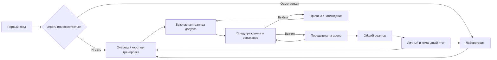

# RuleRoom: проект качественного публичного выпуска

**Главное решение:** довести короткое выживание в меняющейся лаборатории до состояния, когда игрок понимает опасность, видит результат собственного решения и хочет попробовать ещё раз. Размер мира, количество предметов и число правил сами по себе этого не обеспечивают.

Это подробное предложение по запросу владельца от 1 ноября 2026 года. Новые механики, численные цели и изменения экономики ниже **не реализованы и не приняты игровым тестом**. Авторитетные текущие значения находятся в `src/`; порядок работ — в [[07-Tasks/Roadmap]], условия выпуска — в [[10-Releases/Release Checklist]]. Этот документ объясняет проектные решения, а не ведёт второй список статусов.

## Навигация

- [Основание и проблемы](#основание-и-проблемы)
- [Образ игры и границы версии](#образ-игры-и-границы-версии)
- [Первая минута и цикл](#первая-минута-и-цикл)
- [Телефон и остальные устройства](#телефон-и-остальные-устройства)
- [Карта с назначением](#карта-с-назначением)
- [Честность и десять испытаний](#честность-и-десять-испытаний)
- [Два новых испытания](#два-новых-испытания)
- [Оформление и звук](#оформление-и-звук)
- [Прогрессия и экономика](#прогрессия-и-экономика)
- [Совместная игра](#совместная-игра)
- [Надёжность и производительность](#надёжность-и-производительность)
- [Плейтест и аналитика](#плейтест-и-аналитика)
- [Выпуск и дальнейшее развитие](#выпуск-и-дальнейшее-развитие)
- [Источники и границы анализа](#источники-и-границы-анализа)

## Основание и проблемы

Проверены исходники кандидата `feat/playable-game-loop@09843e2`, локальные отчёты и сохранённые изображения. PR8 на момент проверки через GitHub API открыт, не слит; base — `feat/laboratory-expansion`. Это не состояние `main`. В этой проектной работе Studio и ввод на компьютере не использовались; игровые тесты заново не запускались.

Уже есть десять правил, забег из шести этапов, общий реактор, явный вход в очередь, личные результаты, заработанные следы, звук событий, лаборатория 180×144 и арена 84×84. Телефон уже получил компактную панель 48 px. Эти изменения сохраняем и улучшаем.

| Наблюдение | Что оно означает для игрока | Решение |
|---|---|---|
| Compact HUD скрывает индивидуальную причину смерти; остаётся «ВЫБЫЛ» | Игрок не учится на ошибке | Короткая причина и один совет в существующей панели после смерти |
| На низком Results скрывается Goal | На телефоне пропадает следующая цель | Личный результат и одна цель выше необязательной таблицы участников |
| Welcome объясняет 4/6 + финал, но не условие командной зарядки | Возможное ощущение потерянной победы | Разделить личный результат, командный реактор и точное условие Wins |
| RedLight меняет цвет пола, оставляя прежние названия/символы цветов | Пол говорит одновременно «красный» и «синий» | Правило управляет также семантическими надписями, Restore возвращает их |
| LowGravity: девять общих звёзд | При 12 игроках некоторым может нечего собирать | Личные учебные звёзды или пополняемые общие маршруты с ограниченным доходом |
| MeteorRain выбирает первые три записи живых игроков | Одни участники получают больше направленных атак | Перемешиваемая очередь целей и статистика назначения |
| SafeZone: формула перехода допускает повтор и исключает одну из альтернатив | Разнообразие меньше ожидаемого | Явный набор доступных следующих зон, проверка всех переходов |
| LavaRise после подъёма оставляет восемь секунд стояния | Слабая вовлечённость | Сначала проверить короткий ритм; затем отдельный прототип второй ступени лавы |
| Четыре покупных следа стоят суммарно 600 монет | Долгосрочная цель быстро заканчивается | Мастерство, личные рекорды и небольшой расширенный каталог |
| Фактическая нагрузка — два native-клиента; MaxPlayers=12 в конфиге | 12 игроков пока обещание проекта | Принимать фактическую вместимость, отдельно сверять настройки place |

Первые строки подтверждены чтением кода; последствия для удовольствия — гипотезы. Для лавы, размера каталога, камеры и сложности нужны наблюдения людей. Отчёт «пережил испытание» не доказывает, что игрок понял правило или уверенно избегал урона.

Техническая матрица 10 правил существует. Последняя регрессия — 12 сценариев, два клиента и счётчики наград, не облачные профили. Два полных Main-забега с Session-профилями записаны до последней поправки Airborne; после неё нужны полные производственные повторения на финальном SHA. Историческую приёмку задержек нельзя автоматически перенести на новую геометрию. См. [PLAYABILITY](../../PLAYABILITY.md), [данные регрессии](../../qa/playable-rule-regression.json) и [[06-Testing/Evidence Index]].

## Образ игры и границы версии

**Обещание игроку:** «Комната меняет правила. Пройди забег из шести испытаний и вместе с командой запусти реактор». Управление — движение и прыжок. Интерес возникает из разных пространственных решений, смены темпа, наблюдения за друзьями и улучшения собственного результата. Точное условие победы объясняется отдельно: минимум четыре успешных этапа, личное выживание в финале и заряженный командой реактор.

Предлагаемый характер: яркая экспериментальная лаборатория с немного озорной автоматикой. У комнаты есть узнаваемое лицо на настенном дисплее и короткие реакции на результат. Для этого достаточно нескольких анимаций и заранее написанных реплик; генеративный NPC и сложная история не нужны. Реплики не заменяют инструкции и не появляются поверх опасности.

Пять принципов: понятное действие сейчас; предсказуемое предупреждение; быстрая возможность исправить ошибку; выразительная обратная связь; горизонтальная прогрессия. Любую новую фичу проверять вопросом: какое решение игрока она делает интереснее?

| Объём | Состав | Зачем |
|---|---|---|
| Первый качественный кандидат | 10 доведённых правил; один законченный визуальный стиль комнаты; полезная лаборатория; телефон; результаты; проверенные профили; понятный общий финал | Получить целостную игру, на которой можно оценить интерес |
| Усиление 1.0 после проверки ядра | Два новых пространственных испытания, второй художественный вариант, мастерство и небольшой каталог | Дать второй и третий сеанс без разрастания архитектуры |
| После подтверждённого интереса | Новые наборы испытаний, события, дополнительные оформления, косметическая монетизация | Развивать то, ради чего возвращаются реальные игроки |

Две новые механики остаются в дорожной карте. Рекомендуемый качественный выпуск 1.0 возможен с десятью доведёнными правилами: наличие двенадцати не является обязательным gate. Если качество десяти текущих правил или телефон не проходят проверку, добавление новых откладывается; следующий контент может выйти уже после 1.0. Не объявлять отсутствие питомцев, торговли, кланов, оружия, отдельной премиум-валюты или боевого пропуска недостатком версии 1.0.

## Первая минута и цикл

### Вход без лекции

Времена ниже — проектные цели после появления управляемого персонажа, а не гарантии загрузки Roblox.

| Время | Что видит и делает новичок | Что проверяем |
|---|---|---|
| 0–5 s | Видит реактор, арену и крупную кнопку «ИГРАТЬ»; вторичная — «ОСМОТРЕТЬСЯ» | Понимает, где основная игра; нет обязательного магазина |
| 5–15 s | Идёт или прыгает к световой отметке; короткая подсказка соответствует устройству | Есть первое осмысленное движение, подсказка исчезает после действия |
| 15–30 s | Вступает на следующей безопасной границе; при ожидании может пройти 10–15-секундную безопасную демонстрацию | Не ждёт весь забег и не появляется под активным ударом |
| 30–60 s | Видит предупреждение, принимает решение, получает объяснимый исход | Может своими словами объяснить правило и ошибку |
| Первый итог | Видит личные успехи, реактор, реально полученные монеты и одну близкую цель | Понимает, зачем повторить, независимо от победы команды |

30 секунд — цель первого осмысленного действия, включая демонстрацию, а не максимальный срок допуска в текущий матч. При входе в начало длинного этапа безопасная граница наступит позже; игрок видит причину ожидания. Короткая демонстрация не обязательна и не блокирует друзей, ожидающих игрока. В общем сервере нельзя персонально менять правила всей комнаты ради одного новичка: обучение отдельно, сложность текущего забега общая. Подсказка первого знакомства появляется только для ещё не освоенного действия и не повторяется на каждом входе.

### Ритм забега

Сохраняем текущие шесть этапов: пять обычных, шестой — реактор. Ориентир 2–3 минуты проверяется фактическими длительностями; 8 s голосования, 3 s передышки и 12 s итогов уже существуют. Каждый этап: короткая команда → видимое предупреждение → действие → безопасное подтверждение исхода. В опасной фазе нет покупок, поздравлений на полэкрана и требований нажать дополнительные кнопки.

Для колоды предлагается контролируемая смена типа действия: пространственный выбор → реакция → движение/сбор → реакция или поиск пути → кульминация → реактор. Не более двух близких задач подряд. Режимы голосования меняют акценты, но не гарантируют лёгкую победу. Не накладывать одновременно луну, исчезновение пола и лазер до отдельного теста совместимости.

### Жизненный цикл и крайние случаи

Поражение относится к одному испытанию; следующий допуск возвращает полное здоровье. На экране смерти: «МЕТЕОР: не успел выйти из метки» и «Следующий этап через …». Таймер показывать только если сервер знает срок. Если срок неизвестен — честное «Ждём завершения этапа».

Наблюдение выбирает живого участника, переключается при его уходе и возвращает камеру владельцу при respawn. При отсутствии живых камера показывает арену, а игра завершает этап без бессмысленного ожидания. Ушедший в «Осмотреться» не возвращается в очередь без своего выбора. Открытое меню не должно оставлять персонажа без управления при автоматическом старте.

Результаты разделяют: «ТВОЙ РЕЗУЛЬТАТ: 4/6», «РЕАКТОР: 8/10, НЕ ЗАРЯЖЕН», «ЗА ЗАБЕГ: +…» и «Следующая цель: …». Wins начисляется только по действующему серверному условию. Нельзя показывать общую неудачу как обнуление честно заработанных монет или скрывать неудачу финала за поздравлением.

Поздний вход: пропущенные этапы обозначены «не участвовал», а не поражениями. Нельзя обещать достижение 6/6 в неполном забеге. Reset, разрыв соединения, смерть на границе Results и повторная доставка события не меняют уже зафиксированный ledger. Результат принадлежит конкретному RunId, TrialId и поколению персонажа.

При входе начиная с четвёртого этапа остаётся максимум три успеха: по нынешнему условию недостижим не только 6/6, но и Wins. До допуска написать: «Вступаешь в текущий забег. Награды за этапы сохраняются; полная попытка — со следующего забега». Не показывать такой итог как неспособность игрока победить.

## Телефон и остальные устройства

Телефон — обязательный путь приёмки для рекомендуемого первого выпуска. На нём проектируем основные действия и затем расширяем представление для ПК. Консоли включаем в поддерживаемые устройства только после настоящей проверки геймпада; эмулятор не закрывает этот пункт.

### Мобильные состояния

| Состояние | Обязательное содержимое | Что убирается из активной зоны |
|---|---|---|
| Rule | Один глагол/команда, таймер, понятное здоровье; в финале — заряд | Магазин, цели, общий каталог, повторяющиеся награды |
| Break | Номер следующего этапа и короткий отсчёт | Длинный разбор прошлого этапа |
| Eliminated | Причина, один совет, возврат/наблюдение | Боевой таймер, который ошибочно выглядит как личный |
| Voting | Три крупные карточки, подтверждение серверного голоса | Мелкие длинные описания |
| Results | Личный исход, общий реактор, начисление, одна цель | Второстепенная таблица ниже/в отдельной раскрываемой области |
| Lobby | Играть, тренировка, косметика, настройки | Постоянные конкурирующие уведомления |

Пример содержания существующей верхней полосы: `▲ НА ЖЁЛТЫЙ   3 s   ♥ 72`. После смерти на её месте: `ЛАВА: поднимись на платформу · вернёшься на следующем этапе`. Длинную инструкцию показывать заранее в безопасной фазе, короткую — во время действия. Нельзя уменьшать шрифт до нечитаемого размера ради `TextFits`.

48 px — текущая высота, не догма: при увеличенном системном тексте допускается рост панели, если сохранён обзор. Проектный бюджет обычного боевого HUD — примерно верхние 15–20% безопасной области маленького landscape-экрана; это внутренний ориентир, не требование Roblox. Центральная область и нижние зоны штатного джойстика/прыжка остаются свободны. Для важных кнопок начальная цель hit-area 48×48 UI px с промежутками; окончательно проверять пальцами на устройстве.

Шкала здоровья должна объяснять остаток здоровья: сердечко + число или достаточно крупные сегменты. Существующая тонкая полоска сама по себе слишком неоднозначна. Прогресс реактора не заменяет здоровье. Изменение урона — короткая локальная вспышка/звук, без тряски всей камеры по умолчанию.

Камера: подобрать расстояние и угол под обычный avatar так, чтобы видеть ноги, ближайшее укрытие и приходящую опасность. Учесть стены/стекло, спины других игроков, высокий/малый avatar и прыжок с низкой гравитацией. Не включать принудительное вращение во время управления. Контекстная стрелка на границе экрана помогает найти цель вне кадра и не перекрывает прыжок.

Матрица размеров: маленький 16:9, длинный экран с вырезом, планшет; реальный Android начального/среднего уровня и реальный iPhone при заявленной поддержке. Проверить одновременные движение + камера + прыжок, смену приложения и возврат, системное меню, экранную клавиатуру/чат, смену типа ввода. При landscape-only корректно закрепить ориентацию; portrait не обещать.

Звук не обязателен для выживания. Цвет дублируется формой, словом и поведением. Поддержать preferred text size, контраст и reduced motion; отсутствие тряски не должно удалять предупреждение. Эти принципы согласуются с официальными [reserved/thumb zones](https://create.roblox.com/docs/ui/position-and-size#cross-platform-factors), [adaptive design](https://create.roblox.com/docs/production/publishing/adaptive-design) и [accessibility](https://create.roblox.com/docs/production/publishing/accessibility).

## Карта с назначением

Сначала доводим существующие 180×144 и 84×84. Простое увеличение арены удлиняет бег, усложняет мобильную камеру и может сделать предупреждения нечестными. Более крупный визуальный мир создаём также фоном и читаемыми вертикальными силуэтами, не вынуждая игрока бежать через пустой ангар.

| Зона | Назначение | Предлагаемая доводка |
|---|---|---|
| Вход и реактор | Немедленно объяснить тему и основную цель | Один крупный реактор с читаемым состоянием, вид на арену, световая дорожка к входу |
| Вход в испытания | Понятная очередь | Ясные «В очереди / Осмотреться», ближайшая граница допуска, физическая точка входа без обязательной прогулки к ней |
| Арена | Честное чтение опасностей | Силуэт пола отделён от стен, чистая поверхность, ориентиры A/B/C/D или формы, мало декора на уровне ног |
| Тренировочный сектор | Научить движению | Существующий паркур + выбор демонстрации конкретной непонятной опасности; мгновенный повтор без дохода за AFK |
| Галерея и архив | Смотреть друзей и учиться | Отсюда видны реальные действия; терминал показывает 10-секундную диораму и один совет вместо стены текста |
| Шкафчик | Самовыражение и близкая цель | Примерка, цена, условие открытия и сравнение с надетым предметом |

Читаемость маршрутов важнее количества мебели. В каждой зоне — собственная крупная форма и локальный акцент; опасные цвета зарезервированы за игровыми сигналами. Постоянный красный декор рядом с RedLight не используется. Ремонтные роботы, кабели, окна в космос, технические этажи работают как фон; их коллизии и частицы не попадают на игровую дорожку.

Первая художественная тема — «Реакторная лаборатория»: светлые читаемые рабочие поверхности, тёмные рамки и ограниченные неоновые акценты. Вторая кандидатная тема — «Орбитальная станция»: окна, звёздное поле и иное окружение при той же проверенной коллизионной геометрии. Новая физическая планировка считается отдельной картой и требует повторной приёмки каждого правила.

Малые находки для исследования допустимы: три безопасных секретных символа в лобби → декоративное звание. Они не должны отвлекать новичка от «Играть», давать преимущество или требовать прыжков вне границ карты. Это задача после основного художественного прохода.

## Честность и десять испытаний

### Общий контракт опасности

У каждого испытания фиксируем: глагол, видимый источник угрозы, начало предупреждения, серверный момент активации, область поражения, урон/смерть, способ восстановления, допустимые позиции, цель мастерства и правила для позднего входа. Клиент анимирует состояние; исход и награда остаются серверными.

Время предупреждения рассчитывается по достижимости: `время чтения/решения + длина безопасного пути / скорость + бюджет сетевой задержки + запас на ввод`. Путь считается до допустимой области для тела персонажа, а не до красивого центра маркера. При speed16 пересечение стороны 84 занимает около 5.25 s без реакции и препятствий; приказ перебежать всю комнату за 3 s неприемлем. Точные величины для каждой геометрии определяют её тесты.

Конкретно SafeZone: центры(±21,±21), квадрат 25.2; из противоположного угла до ближайшей границы примерно 71.28stud, или 4.45s бега. При предупреждении 5.5s остаётся около 1.05s на распознавание и сетевой/управляющий запас; поправка на размер тела ещё уменьшает запас. Если увеличить поле до 120 с пропорциональными зонами, путь займёт 6.36s: старый таймер станет недостаточным.

Сеть не оправдывает невидимый удар. Во время проверки записывать полученный клиентом telegraph и реально оставшееся время; поздно полученное предупреждение не заменять доказательством того, что сервер показал его вовремя. Балансируем под выбранный сетевой бюджет, не обещаем безошибочную игру при любой задержке.

| Правило | Решение игрока | Доводка для качественной версии | Приёмка |
|---|---|---|---|
| SafeColor | Найти ближайшую плитку нужного знака | Совпадающие знак/слово/цвет на HUD и полу; распределение всегда оставляет достижимую плитку; первая волна обучающая | Все начальные позиции и переходы между цветами, край плитки и прыжок; понятность без различения цветов |
| LaserSweep | Выбрать момент прыжка | Видимая линия старта и направление; понятный низкий луч; границы визуала совпадают с hitbox | Штатные прыжки без урона при верном времени, разные avatars/FPS/сеть; стояние не даёт бесплатной награды |
| LowGravity | Планировать прыжки между целями | Маршруты низкий/обычный/рискованный; достаточно целей всем, повторяемое движение вместо ожидания | Каждый из 12 имеет разумную возможность собрать цель; сила гравитации восстанавливается после смерти/выхода/следующего правила |
| RedLight | Двигаться на разрешение и вовремя остановиться | Единый световой сигнал; скрывать старые названия цветов на полу; согласованный запас на торможение | Микродвижения на месте, инерция, прыжок перед сигналом, касание стены, задержки; обычная остановка не считается читом |
| LavaRise | Вовремя занять возвышение | Укрытия видны до подъёма; после первой версии короткое напряжённое удержание либо проверенная вторая ступень | Любая стартовая точка имеет достижимую платформу; хватает места всем; нет невидимой лавы на безопасной поверхности |
| MeteorRain | Читать метку и уходить с неё | Перемешиваемая очередь целей; различимая квадратная граница и заполнение метки перед ударом; между метками остаются пути | Равномерность назначения на больших сериях, возможность ухода при худшем сочетании, потеря цели при disconnect |
| DisappearingTiles | Смотреть вперёд и выбирать путь | Плитка трескается/мигает перед исчезновением; понятный ритм восстановления | Нет неизбежного окружения; все оставшиеся пути рассчитаны для штатного прыжка, толпа не блокирует выход |
| SafeZone | Найти безопасную область и успеть перейти | Исправить выбор следующей зоны; достаточный размер; явное направление и контур | Все допустимые переходы/стартовые точки достижимы; повтор зоны только если это намеренный дизайн, не ошибка формулы |
| Spinner | Выбирать позицию и момент прыжка | Читаемые скорость/направление; исключить бессмысленное стояние в углу; ограничить визуальное перекрытие толпой | Осмысленная техника проходит с низким/нулевым уроном; стратегия AFK не даёт систематическое освоение/мастерство |
| ReactorRush | Собирать общий заряд и одновременно выживать | Ясная командная цель, личный вклад, поведение при уходах; после зарядки понятное «Удержитесь!» | Solo/2/целевой максимум, уходы/смерти до и после заряда, ровно на конце, один оставшийся; награды однократны |

### Луна, лава и финал требуют отдельных решений

Для луны сравнить два маленьких прототипа. **Личные учебные звёзды:** всем есть чем заняться, сервер хранит личный сбор и бюджет, клиент лишь отображает свои цели. **Общие возобновляемые маршруты:** проще сохраняют социальный сбор, но требуют ограничить преимущество быстрого игрока и доход. Предпочтение для спокойного обучающего испытания — личные цели; это изменение контракта, его нельзя включать незаметно вместе с исправлением HUD. До решения достаточно устранить дефицит целей, не умножая монеты без расчёта.

Лава: сначала наблюдать, скучны ли восемь секунд людям. Если да, предпочтительный прототип — два подъёма со спадом лавы и безопасным наземным переходом между ними. У текущих платформ ширина 11.2, шаг центров 28, зазор 16.8stud. Обычный прыжок при JumpPower50, gravity196.2 и speed16 покрывает лишь около 8.15stud до прежней высоты. Поэтому требование перепрыгнуть с нынешней платформы на соседнюю физически неверно. Если переключение укрытий происходит без доступного пола, нужны промежуточные опоры и отдельная регрессия; при полном спаде достаточно безопасного наземного пути, времени перехода и предупреждения подъёма. Нельзя оживлять испытание скрытым разрушением занятого укрытия без доступного выхода.

Реактор: цель определяется числом допущенных участников, а не всеми игроками в лобби. При смерти цель не уменьшается автоматически — иначе полезно специально умереть. Для disconnect предлагается явно описанная политика с задержкой и нижней границей, без выдачи дополнительной награды от уменьшения знаменателя; альтернатива — не менять цель, но обеспечить одному выжившему достижимый остаток. Эти варианты сравнить отдельно и выбрать один, протестировав deliberate disconnect/rejoin. Уже собранный вклад ушедшего сохраняется один раз; после достижения цели она не растёт.

Финал показывает три состояния: «СОБЕРИТЕ 7/10» → «ЗАРЯЖЕН. ВЫЖИВИТЕ 4 s» → подтверждённый результат. Нужен вклад без чата: светящиеся маршруты и понятный оставшийся заряд. Ни одного обязательного интерактивного QTE поверх кнопки прыжка. У игрока с 4/6 и незаряженным реактором сохраняется личное достижение, но текст не обещает Wins.

Предлагаемая точная модель нового таймера: сбор ограничен 24 s; первое достижение цели до дедлайна однократно запускает 4 s стабилизации, максимум 28 s активности суммарно. Последующие сборы/повторные callbacks не перезапускают срок. Заряд на 23.9 s даёт полную стабилизацию, а не скрытые 0.1 s. Проверить пограничное серверное время и единый порядок: обновить выбывание → принять допустимые сборы живых → проверить достижение цели → проверить истечение срока. Клиентский timestamp не является доказательством своевременного сбора. Гибель последнего живого на любой фазе означает командное поражение. Это предложение изменяет нынешнюю фиксированную фазу и требует обновления контракта и регрессии.

### Сложность и мастерство

Сложность меняет один параметр за шаг: больше волн, другой разрешённый маршрут или меньше безопасных участков. Не менять одновременно скорость, цвет, урон и направление. На экране до этапа видна версия правила. Обычный режим должен быть полноценно интересен без обязательного «хардкора».

После освоения допустим отдельно обозначенный сложный набор. До него собрать распределения времени реакции, урона и смертей по устройствам/числу игроков. Игрок, переживший лазер с 8HP или Spinner с 2HP, доказал выживание, но ещё не доказал устойчивую технику. Для приёмки нужно как прохождение, так и проверка удачного избегания урона.

Политику здоровья следует закрепить явно: сейчас регенерация означает, что 35 урона не равно гарантированному поражению после трёх контактов. Не отключать регенерацию до доказанного честного уклонения: это может превратить нынешние успешные проходы в смерти. Предлагаемый контроль —20 правильных пересечений LaserSweep без урона и Spinner на нескольких радиусах, плюс намеренные попадания,30/60FPS и выбранная задержка. «Без урона» определяется журналом попаданий, а не полным HP в конце. Не каждая неподвижность — чит: в RedLight спокойное стояние допустимо для выживания, но не для дополнительной медали сбора.

## Два новых испытания

### Волна давления

Действие: определить направление вентиляционного фронта и спрятаться **за** укрытием относительно этого направления. В отличие от лазера прыжок не является решением. До волны светится исходная стена, появляются стрелки потока и отмеченные безопасные тени. Первая волна — одно направление; следующая меняет сторону с достаточным временем на переход.

Для первой реализации укрытия статичны, безопасные области вычислены заранее; сервер проверяет положение в области, не требует сложной нестабильной физики отталкивания. Тело в проёме считается открытым по заранее выбранному правилу. Не использовать сильный импульс, отправляющий людей сквозь стены. Укрытий хватает на фактическую вместимость, персонажи не выталкивают друг друга. Проверить видимость теней без звука, переходы между сторонами, края укрытий и толпу.

### Меняющиеся стены

Действие: заранее прочитать последовательность проёмов и выбрать маршрут через комнату. Проём подсвечен рамкой и знаком; соседние секции стены показывают закрытие. Решение — планировать путь, а не просто перепрыгнуть движущийся луч.

Первый прототип использует неподвижные секции, которые по сигналу меняют проходимость. Визуальное движение и серверный collider синхронизированы; игрок в закрывающемся проёме получает предусмотренный безопасный выход/отсрочку, а не физический fling. От каждой допустимой позиции существует путь в следующую область. Матрица проверяет граф доступности, время пути, границы закрытия и 12 игроков. Урон, прохождение и награды используют существующий контракт испытаний.

Оба прототипа сначала испытываются без наград на отдельном локальном стенде. В основную колоду входят после собственного успех/ошибка/reset/late-join/cleanup теста и человеческого объяснения правила. Одновременно с ними не менять весь баланс старой колоды.

## Оформление и звук

### Визуальный язык

Один художественный набор для комнаты: панели, рамы, двери, укрытия, генератор/реактор, дисплеи и световые полосы. Одинаковая шкала деталей, толщина рам и материалы. Крупные формы читаются с телефона; тонкие декоративные линии не используются как важные подсказки. Существующие примитивы годятся для основы; выбор mesh-ассетов определяется читаемостью и стоимостью отображения, а не количеством полигонов.

Приоритет видимости: опасность → безопасное решение → персонажи → прогресс → фон. Предупреждение меняет форму/положение, не только оттенок. Лазер имеет ясный край; метеор — квадратную метку на полу до удара, соответствующую текущему квадратному hitbox11×11; исчезающий пол — состояние «скоро пропадёт»; реактор — понятные ступени заряда. Круглая метка при квадратном серверном поражении недопустима; переход к кругу потребует одновременного изменения математики и регрессии. Каждый эффект имеет ограниченный срок и cleanup.

Комната реагирует на забег: секции реактора загораются по ходу, настенный дисплей меняет выражение, после успеха на 1–2 s вспыхивает общий световой рисунок. Поражение — короткое безопасное растворение/возврат; без унижающих реплик и тяжёлых эффектов, закрывающих друзьям угрозу. Следы других игроков ослабляются на арене, если маскируют пол; косметика не может выглядеть как предупреждение опасности.

### Аудиоплан

| Слой | Роль | Правило микса |
|---|---|---|
| Лобби | Тихий фон и характер лаборатории | Не утомляет при нескольких повторах; отдельная громкость музыки |
| Предупреждение | Немедленно обратить внимание | Короткий узнаваемый сигнал; подавляет менее важные звуки |
| Активная угроза | Понять фазу/направление | Пространственный источник, где уместно; видимый дубль всегда есть |
| Прыжок/попадание/сбор | Подтвердить действие | Частые звуки короткие, ограничены по частоте и числу голосов |
| Реактор | Создать нарастание общего усилия | Интенсивность связана с зарядом; не заглушает предупреждение |
| Итог | Подтвердить личный и командный исход | Один запуск на результат, без наложения победы и поражения |

Приоритет: опасность > важный личный исход > сбор > музыка/фон. Для 12 игроков не проигрывать всем 12 громких pickup одновременно; локальный сбор выделять, чужой приглушать. Музыка/эффекты регулируются отдельно, mute и reduced motion сохраняются после появления профиля с проверенной схемой. Сначала использовать лицензированные/свои ассеты с подтверждённым доступом игре. Обязательны прослушивание на динамике телефона и наушниках, проверка пауз, respawn, повторного Results и недоступного asset.

## Прогрессия и экономика

### Три горизонта целей

Сейчас: «пережить это правило». На забег: «улучшить свой результат и помочь реактору». На несколько сеансов: «освоить новые правила и получить выбранное оформление». Уровень — понятный статус опыта, а не скрытый множитель скорости или здоровья.

Предлагаемый стартовый набор целей: первый законченный забег;6/6; три разных испытания без урона; первый личный рекорд паркура; пять успешных общих финалов. Командное достижение «каждый внёс вклад» вводить только после проверки доступности зарядов каждому и определения группы на старте финала. Позднего зрителя не включать в знаменатель.

Мастерство хранится сервером как компактные счётчики/флаги. Правило «без урона» исключает reset и пропущенные этапы; недопущенный или AFK не получает достижение за отсутствие контактов. Награда выдаётся один раз при пересечении условия, не при каждом открытии меню. Повторная доставка, rejoin и миграция профиля имеют отдельные проверки.

AFK для этих целей не определяется единым порогом перемещения: правильно стоять на красном или удерживать укрытие допустимо. У каждого достижения своё серверно проверяемое действие: пересечение луча прыжком, сбор на зелёной фазе, прохождение маршрута. Отсутствие урона дополняет это условие, но не заменяет его.

Каталог-кандидат: восемь выразительных следов суммарно, включая существующие четыре, и четыре звания за мастерство. Лучше меньше различимых предметов с хорошей примеркой, чем двадцать почти одинаковых цветов. Первая косметика достижима в первых 1–2 результативных забегах; дальняя цель — в нескольких сеансах. Это желаемый темп, который нужно измерить.

### Не увеличивать цены наугад

Текущая формула:12 монет за выживание,2 за сбор,15 за результативное завершение,20 за победу. За 6/6 с победой без pickup получается 107; за 4 успешных этапа без победы —63. Каталог 600 монет при таком постоянном темпе исчерпывается приблизительно за 6–10 забегов без учёта заданий и сборов. Это расчёт по конфигу, не наблюдение реальной скорости новичка.

Перед ценами нового каталога собрать доход p25/p50/p75 на забег и время до первой покупки. Увеличение звёзд в луне требует отдельного ограничения/пересчёта дохода. Не компенсировать скудность контента резким десятикратным удорожанием старых вещей; уже купленное остаётся у игрока.

Ежедневные задания мягко предлагают повторить знакомое: сыграть, освоить, помочь. Нет потери серии за пропуск, платного восстановления и искусственного запрета играть. Сначала сохраняем нынешние задания, улучшаем описание и выдачу; дополнительные валюты и календарь наград не нужны. Меню показывает одну выбранную цель, каталог и достижения доступны по желанию.

Покупка: примерка → цена/баланс → серверная проверка → один подтверждённый результат. При отказе объясняется причина; кнопка не зависает, повтор не списывает деньги. В Session/fallback честно предупреждать до первой значимой покупки, что текущий прогресс временный. Вход в общую игру при ненадёжном профиле определяется отдельно; никогда не перезаписывать настоящие данные временными.

Подтверждённый пробел текущего входа: при Busy/Unavailable предупреждение заметно прежде всего в коллекции, а Welcome способен показать обычную готовность. До первого участия нужен выбор «Повторить загрузку / Играть временно / Осмотреться» с ясным объяснением несохранения. Повторная загрузка — ограниченная серверная операция, не бесконечный retry и не перехват чужой аренды. При утрате аренды посреди забега показывать новое состояние и не обещать сохранённые награды. Эти пути важнее расширения магазина.

Монетизация после подтверждения качества: дополнительные косметические стили/оформление результатов с честной примеркой и понятной ценой. На данном этапе Robux-продуктов нет. Если появятся, они получают отдельные серверные receipt/retry/refund/ownership проверки. Продажа здоровья, скорости, безопасного места, платного возрождения или доступа к обязательным подсказкам разрушает основу режима.

## Совместная игра

Игра должна работать solo без ожидания других. Вместимость 12 — цель, пока не доказанная приёмкой. Для друзей важны общий ритм, видимый вклад и возможность оставаться вместе после поражения. В результатах показываем участников, их личные этапы и заряд; не публикуем унизительные звания «худший игрок».

Предлагаемые социальные детали: короткая реакция «Спасибо» после финала, выделение собственного друга в наблюдении, одна необязательная возможность пригласить друга в лобби через разрешённый платформенный путь. Ни подсказки, ни реактор не зависят от наличия чата. При недоступности приглашения игра продолжает работать, окно не открывается автоматически после смерти.

Персонажи не должны выталкивать друг друга из безопасной зоны; пол и опоры при этом сохраняют физические коллизии. Части лазеров, лавы и метеоров остаются CanCollide=false, их урон проверяется серверной геометрией: превращать их в физические препятствия не нужно. Сбор и голосование защищены от повторов и спама. Уход последнего участника завершает игровой этап и возвращает Waiting, не создавая бесконечных пустых забегов. Игрок в галерее не повышает сложность финала и не получает награду за наблюдение.

Группы коллизий уже реализованы; это задача подтверждения на всех принятых аватарах и полной нагрузке, не предложение заново писать систему. Предлагаемый путь ёмкости: фактически проверенные 2 → проверенные 4 →8 →12 в подходящей среде. Локальный API ранее отклонил 12, принимая максимум 8. Dummy-модели не заменяют клиентов. Если первый выпуск ограничивается меньшим количеством, отдельно согласовать продуктовый cap, синхронизировать admission, Max Players в place и описание. Снижение только admission оставит лишних посетителей ждать без места.

Взаимодействия, где один человек может заблокировать всех, не входят в первый выпуск. Общая цель не отменяет личные деньги за пройденное. Если один игрок подключился с медленной загрузкой, его не штрафуют как сознательно проигравшего до готовности персонажа.

## Надёжность и производительность

### Сохранения, сервер и версия

Сохраняем существующий ProfileService и архитектуру Rojo. Новые достижения/настройки добавляются через версионированную миграцию и значения по умолчанию. Для изменения схемы заранее определяем, способен ли предыдущий build читать новый профиль. Если нет, откат place без плана данных недопустим.

Настоящие проверки: заработать обычным путём → autosave → другой сервер → сравнить Coins/XP/Wins/quests/owned/equipped; затем быстрое переподключение, конкурирующая аренда, shutdown и временный отказ. Изолированные адаптеры полезны для ошибок, но не заменяют реальный сервис. До отдельного разрешения приватной публикации эти пункты остаются открытыми.

RemoteEvents несут намерение, а не сумму награды или вердикт о прохождении. Проверять тип/диапазон/частоту/актуальную фазу/участие/RunId. Один ключ операции защищает от повторного начисления; устаревшая ссылка на персонажа не награждает новое поколение. При уходе отменяются относящиеся к нему задачи и listeners. Серверный урон не зависит от клиентской картинки.

Для каждого QA-артефакта обязательны commit SHA, hash сборки, версия Studio/toolchain, scenario/seed, реальные клиенты/устройства, тип профилей, параметры сети и raw-результат. У старого манифеста без SHA нельзя задним числом придумать принадлежность. Новый финальный прогон записывается с полной идентичностью.

### Производительность с измеримым бюджетом

Предлагаемая цель для минимального поддерживаемого телефона — устойчивые 30FPS при худшем принятом испытании и целевой вместимости;60FPS — желательная цель на более сильных устройствах. Сначала выбрать конкретные модели и качество графики. Для 30FPS бюджет кадра 33.3ms; смотреть p50/p95/p99, длинные паузы и нагрев, а не среднее число FPS в пустом лобби.

Серверный цикл опасностей сейчас имеет шаг 0.05s: нужно измерить фактический интервал и задержки под нагрузкой; визуальная плавность не доказывает своевременность урона. Не пересылать покадрово все эффекты; клиент анимирует по фазе/времени, сервер контролирует результат. В сетевом профиле фиксировать именно одностороннюю задержку и RTT, не смешивать их.

Проверять минимум: заполненная арена с косметикой, метеоры/реактор, массовый respawn, переход результатов, открытие магазина, повторные 10–20 забегов и 30-минутный телефонный сеанс. Сравнивать память/Instances/listeners после возврата в одно и то же состояние с прогретыми ассетами. Устойчивый рост без выхода на плато — повод расследования; произвольный общий лимит памяти без устройства не является приёмкой.

Сборщик профиля пишет ограниченные окна/агрегаты: предыдущий длинный collector упёрся в лимит StringValue, такой результат не принят. Добавить build ID к диагностике и управляемое выключение конкретного неисправного правила с проверенным fallback колоды. Этот аварийный путь не должен ломать обязательный финал или менять сохранённые данные; сам механизм также тестируется.

Оптимизация по профилю: отключение теней у мелкого декора, ограничение частиц/света/голосов, повторное использование временных эффектов где оправдано, отсутствие тяжёлых циклов по всему Workspace, проверка невидимых UI. Streaming не включать ради галочки: если он нужен по замерам, опасность не должна активироваться до доступности критического пола/укрытий на клиенте.

## Плейтест и аналитика

### Наблюдать людей до масштабирования

Первый раунд:6–10 независимых игроков, в том числе несколько на телефонах, часть solo и часть парами. Это поиск проблем, не статистическое доказательство популярности. Не объяснять правила во время первой попытки; отмечать вопрос, заминку, причину смерти со слов игрока и добровольное желание продолжить. Участие детей — только в подходящем согласованном формате; имена, записи голоса и другие личные данные не помещаются в репозиторий.

Сценарий: свободный первый вход → один забег → самостоятельный выбор продолжать/уйти/осмотреться → первая примерка → второй забег по желанию. После — три вопроса: «Что нужно было делать?», «Почему ты проиграл?», «Что хотелось попробовать ещё?». Наблюдение важнее оценки «прикольно» из вежливости.

Начальные внутренние ориентиры: первое осмысленное действие за 20–30s;8 из 10 новичков объясняют первое правило; большинство может объяснить первую смерть; хотя бы половина добровольно пробует второй забег. Их назначение — выявлять проблему, а не гарантировать доход или быть универсальными нормами Roblox. Если выборка маленькая, публиковать `7/10`, а не убедительный на вид процент без контекста.

Автоматическое возвращение очереди не равно добровольному второму забегу. Нужны отдельные сигналы намерения и активного участия. Человек, стоящий AFK в автоматически начатом цикле, не подтверждает интерес к повтору.

### Что измерять

| Событие/метрика | Определение | Какое решение помогает принять |
|---|---|---|
| Вход → управляемый персонаж → Play | Разделяет загрузку и непонятное меню | Ускорить загрузку или изменить первый экран |
| Первое предупреждение/действие/исход | С привязкой к правилу и фазе | Найти неясную инструкцию и поздний telegraph |
| Показ результатов | Не зависит от хотя бы одного выживания | Учитывать новичков с 0/6, которых сейчас можно потерять из воронки |
| Намерение повторить / фактическое участие | Разные события | Отделить интерес от автозапуска |
| DeathCause, RuleVariant, число участников | Ограниченный набор значений | Выявить несправедливый этап/дисбаланс толпы |
| Монеты за забег / первая покупка | Реальные начисления без двойного счёта | Настроить темп косметики |
| SaveFailure / lease / fallback / duplicate-rejected | Технические счётчики | Остановить распространение версии при риске прогрессу |
| Время кадра/старт/выход | Сегменты устройства и версии | Найти техническую причину ухода |

Текущий `Analytics.server` связывает FirstRunCompleted с SessionRuns, который растёт после результативного завершения, и не доказывает просмотр результатов при 0/6. Новую воронку версионировать; не менять значение старого события молча. Для повторяемых забегов использовать отдельный идентификатор, для первого опыта — устойчивую семантику. Отказы аналитики не блокируют игру; ретраи ограничены, без бесконечного spam.

Официальные funnel-события отправляются сервером в опубликованной игре; локальный атрибут/Studio не подтверждает доставку в Creator Analytics. Поэтому до разрешённой публикации проверяем только логику эмиссии и локальные данные. См. [Funnel events](https://create.roblox.com/docs/production/analytics/funnel-events).

После ограниченного доступа анализировать D1/D7, повторные дни и совместную игру по устройствам/версиям/источникам прихода. Не ставить рекламный бюджет на гипотезу «больше контента значит выше удержание». Roblox рекомендует прежде всего качество ядра, возвращение игроков и достоверное представление игры; единственного сигнала, гарантирующего рекомендации, нет. См. [Discovery FAQ](https://create.roblox.com/docs/discovery-faq).

## Выпуск и дальнейшее развитие

### Пакет, который можно показывать

Название-кандидат: «RuleRoom — Комната меняет правила». Первое предложение описания: «Пройди забег из шести меняющихся испытаний и вместе с командой запусти реактор». Затем понятные управление, solo/друзья, возврат после поражения и косметика. Вместимость/платформы обещать только принятые.

Иконка: узнаваемый реактор/комната, читаемая на малом размере. Три обложки: реальное испытание, совместный финал, характер лаборатории. Короткий ролик 15–25s из настоящего gameplay без обещаний отсутствующих функций. Показать прыжок, поиск укрытия и командный момент, а не только облёт пустой карты. Концепт-арт не выдавать за скриншот готовой игры.

Проверить права и разрешения всех ассетов именно для целевой experience, недоступные звуки, локализацию строк, корректность рейтинга и настройки устройств. Русский и английский — разумный первый набор; текст хранить через общие ключи, не добавлять новые жёстко заданные строки по нескольким скриптам. Расширенные/длинные строки проверять в компактном HUD.

### Последовательность выпуска

Сначала принятый локальный кандидат и воспроизводимый build; затем после отдельного разрешения — приватная облачная проверка; затем ограниченный плейтест и исправления; после этого решение о публичной доступности. Облачная публикация в этой задаче не выполняется. Расходы и настройки аккаунта также не меняются.

На дату исследования требования Roblox для доступа аудитории младше 16 включают отдельную проверку создателя/игры; нельзя обещать детскую аудиторию сразу после переключателя Public. Официальная страница описывает verification,2FA, подписку либо сбор и evaluation, включая 250 уникальных plays от подходящих age-checked игроков за 60 дней. Это нужно повторно сверить в Audience Reach перед выпуском; состояние аккаунта владельца здесь не проверено. [Kids and Select](https://create.roblox.com/docs/production/publishing/kids-and-select), [публикация](https://create.roblox.com/docs/production/publishing/publish-games-and-places).

Для сборки выпуска сохраняются SHA, hash артефакта, place version, миграции и предыдущая проверенная версия. Подтверждённая потеря/дублирование прогресса, невозможность завершить забег или массовая неиграбельность на поддерживаемом устройстве — остановка расширения доступа и разбор причины. Откат учитывает совместимость профилей; нельзя запускать старый код, который затрёт новые данные.

Первые обновления после запуска должны отвечать на наблюдения: если новичок не читает сигнал — улучшить сигнал; если уходит после смерти — исправить объяснение/ожидание; если после двух забегов всё знакомо — добавить проверенную вариацию; если не покупает — проверить ценность/примерку, а не сразу повышать давление продаж. Частота обновлений определяется возможностью проходить регрессию, не обещанием ежедневного контента.

## Источники и границы анализа

**Код и локальная история:** `src/shared/GameConfig.luau`, `EconomyConfig.luau`, `src/server/ArenaRules.luau`, `PlayerRoster.luau`, `ProfileService.luau`, `Analytics.server.luau`, клиентские HUD/Station/CollectionPanel/CharacterPresentation/AudioController; `tools/build_assets.py`; [PLAYABILITY](../../PLAYABILITY.md), [LAB_EXPANSION](../../LAB_EXPANSION.md), [QA_REPORT](../../QA_REPORT.md). Идентичность: `09843e2`. Изображения сохранённых тестов — `docs/media/`; их просмотр не является новым запуском или испытанием телефона.

**Официальные источники, просмотрены 2026-11-01:** [onboarding](https://create.roblox.com/docs/production/game-design/onboarding), [UI/UX](https://create.roblox.com/docs/production/game-design/ui-ux-design), [adaptive design](https://create.roblox.com/docs/production/publishing/adaptive-design), [accessibility](https://create.roblox.com/docs/production/publishing/accessibility), [funnel events](https://create.roblox.com/docs/production/analytics/funnel-events), [discovery FAQ](https://create.roblox.com/docs/discovery-faq), [publishing](https://create.roblox.com/docs/production/publishing/publish-games-and-places), [Kids and Select](https://create.roblox.com/docs/production/publishing/kids-and-select). Они подтверждают платформенные принципы и ограничения. Конкретный дизайн RuleRoom, внутренние бюджеты и продуктовые цели — предложения этого документа.

[[01-Game-Design/GDD]] · [[01-Game-Design/Player Experience]] · [[07-Tasks/Roadmap]] · [[10-Releases/Release Checklist]] · [[00-Dashboard/Dashboard]]
