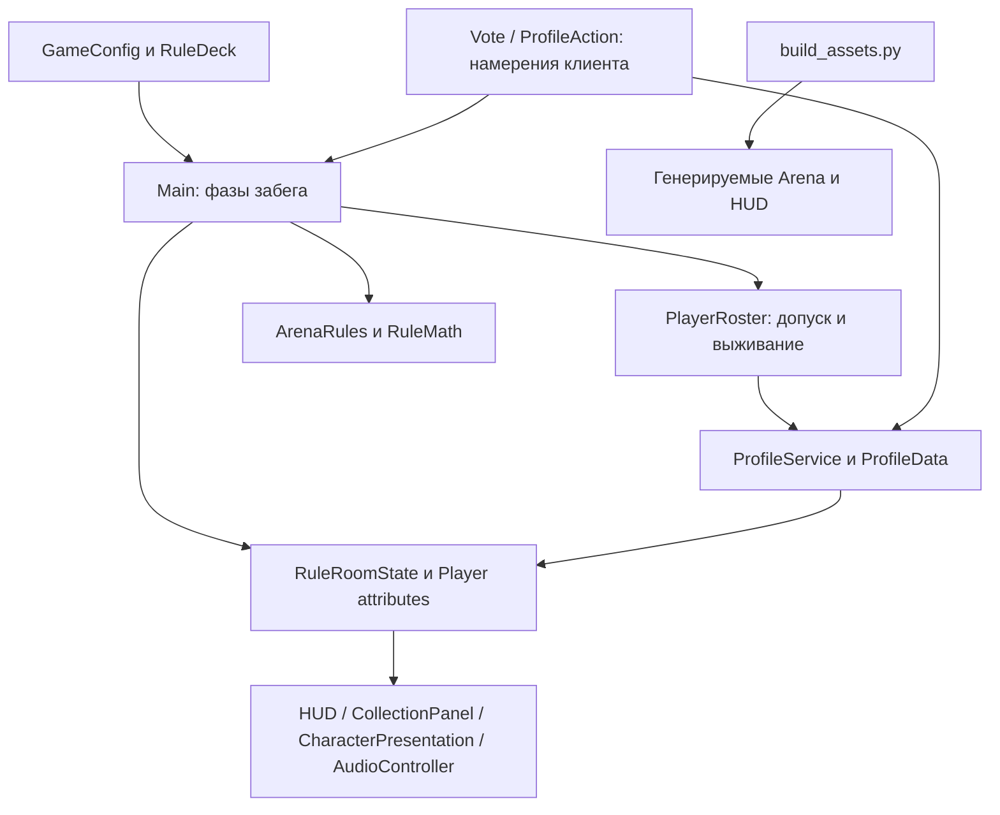

# Архитектура и доверие

Rojo собирает файловые исходники в Roblox DataModel. Сервер определяет допуск, опасность, здоровье, награду и профиль; клиент показывает реплицированные атрибуты и отправляет намерение.

Клиент не задаёт цену, деньги, координаты успешного сбора или результат испытания. Vote допускает только разрешённый режим в Voting; ProfileAction допускает Purchase/Equip/ClaimQuest с серверной проверкой ID, состояния и частоты.

`ReplicatedStorage.RuleRoomState` — общая фаза, правило, deadline, голоса, заряд, финал и текст итогов. Атрибуты Player — допуск, личный результат и отображаемый профиль. Схема и названия определены [ALPHA_CONTRACT](https://github.com/ikanit1/boblox/blob/afdbc080023d3c4ff785805aff44b214ee1b6ca7/docs/ALPHA_CONTRACT.md).

В `default.project.json` уже есть два RemoteEvent; создавать параллельные remotes или второй сервер профилей не нужно. Долговременные правки делают в исходниках, не только в Studio или генерируемом XML.

[[02-Architecture/Source Map]] · [[03-Gameplay-Systems/Round Lifecycle]] · [[08-Decisions/Decisions]] · [[00-Dashboard/Dashboard]]
