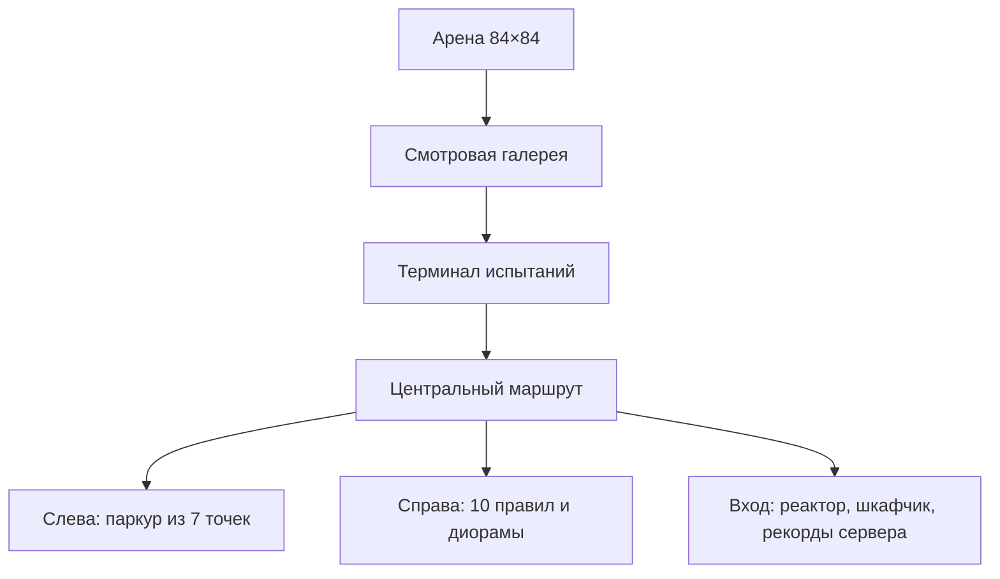

# Лабораторный комплекс

Кандидат расширения: игровое поле 84×84 studs, отдельный комплекс ожидания 180×144. Исходники мира — tools/build_assets.py и tools/build_station.py. Все объекты оригинальные редактируемые примитивы и SurfaceGui, без загрузки ассетов Roblox.

Сетка 6×6: плитка 14×2×14, центр Y=0, X/Z −35, −21, −7, 7, 21, 35. Половина квадрата 42. ArenaSpawn (0,5,0); LobbySpawn (0,4,158). Лобби X −90..90, Z 48..192; узкий мост заканчивается у границы арены. EliminationY=−15.

Лабораторию можно исследовать отдельно: LobbyOnly исключает из голосования и допуска. В испытания возвращает Join на штатной границе. Паркур: серверное время, последовательные точки, возврат после падения, временный рекорд до выхода с сервера. Наград за бездействие и тренировку нет. Лунный эффект действует только на участников испытания через временные силы. Гравитация сцены и тренировки остаётся 196.2.

Под плитками нет поддерживающей плиты. Постоянные collision-объекты не пересекают игровую сетку; tools/verify_world.py проверяет это при каждой сборке. Опасности под RuleEffects, декор за границами, VFX без collision. Размеры луча, лавы, платформ, зон и звёзд согласованы с GameConfig; увеличение площади требует повторной runtime-приёмки.

Подробности и ограничения: docs/LAB_EXPANSION.md. До слияния feature PR main остаётся прежним. Физические устройства, облако и 12 клиентов остаются отдельными открытыми gate.

[[04-Assets/Asset Register]] · [[01-Game-Design/Rule Catalog]] · [[06-Testing/Verification]] · [[00-Dashboard/Dashboard]]
