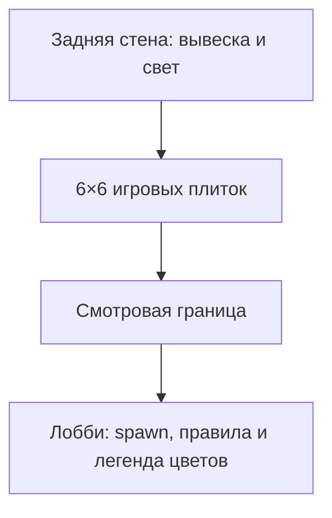

# Комната и безопасные ограничения геометрии

Одна неоновая исследовательская комната с игровой сеткой и отдельной зоной ожидания. Сетка 6×6: плитка 10×2×10 studs, центр Y=0, координаты X/Z −25, −15, −5, 5, 15, 25. Половина игрового квадрата — 30 studs. Цвета Blue/Pink/Yellow/Green дублируются символами и русскими названиями.

ArenaSpawn около (0,5,0). Лобби находится снаружи сетки, LobbySpawn около (0,3,52). Под плитками нет дополнительной поддерживающей плиты: исчезновение должно открывать пустоту. `EliminationY=-15` — граница выбывания, не верхняя поверхность пола.

Не добавлять декор, который создаёт безопасный скрытый пол, перекрывает прыжок, блокирует обзор warning или меняет достижимость платформ. Декоративные рёбра и световые полосы размещены у стен. Следы и декоративные эффекты не имеют collision. Динамические опасности живут под RuleEffects и удаляются при восстановлении.

Авторитетный источник: [build_assets.py](https://github.com/ikanit1/boblox/blob/afdbc080023d3c4ff785805aff44b214ee1b6ca7/tools/build_assets.py), мир в [ALPHA_CONTRACT](https://github.com/ikanit1/boblox/blob/afdbc080023d3c4ff785805aff44b214ee1b6ca7/docs/ALPHA_CONTRACT.md). Правки только в `.rbxlx`/генерируемом XML исчезнут при сборке. Идея второго варианта комнаты пока не реализованное содержимое.

[[04-Assets/Asset Register]] · [[01-Game-Design/Rule Catalog]] · [[06-Testing/Verification]] · [[00-Dashboard/Dashboard]]
